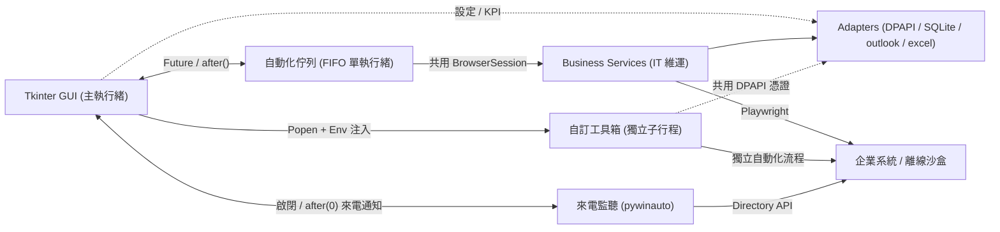

# IT RPA Suite (IT 自動化助手)

[](https://github.com/lanjztaipei/it-rpa-suite/actions/workflows/ci.yml)


Windows GUI 桌面應用程式，將企業 IT 的繁瑣日常維運，轉化為高效率的自動化流程。

由個人從零開始逐步迭代，最後導入 3 個廠區 8 位同事使用，每人每月至少節省 20 小時，並大幅減少出錯機會。

---

## 系統架構與核心技術

專案採分層模組化（View / Service / Adapter）搭配執行緒與子行程隔離架構，兼顧畫面流暢、自動化穩定與外掛擴充彈性：



- **UI/UX 體驗**：以 Tkinter / ttk 打造現代化極簡介面，支援自適應縮放與深淺色主題切換。
- **憑證與資料保護**：帳密透過 Windows DPAPI 綁定本機帳號加密保存；設定檔採用原子寫入防止寫入毀損。
- **快速發佈與更新**：結合 GitHub 自動化品質檢查、開發者一鍵發佈流程與使用者一鍵更新機制。
- **離線沙盒驗證**：內建本機 Mock HTTP Server 完整模擬企業系統，免連內網即可體驗與執行 E2E 測試。

---

## 1. 專案概述

在大型企業中，IT 日常維運常面臨以下挑戰：

1. **系統破碎、資訊孤島**：需頻繁切換於資產管理系統、人事異動系統、企業電話簿、電信分機系統、網路存取控制系統（NAC）與 IT 服務台等多種系統與通訊軟體之間。許多流程需在 3 至 5 個系統之間切換，中間還需穿插各種電話與郵件。
2. **重複性高且易生人為失誤**：充斥大量制式化規則，人工操作耗時、耗神，且偶有誤植又要額外補救。
3. **缺乏量化追蹤與績效可視化**：大量操作往往成為「隱形成本」，無法直觀向上級主管證明人力價值。

**IT RPA Suite** 正是上述痛點的整合式解決方案，在不改動既有系統的前提下，實現端到端業務流程自動化。

---

## 2. 里程碑功能

### 2.1 專案的起源：設備借用、歸還與保管人反查

- **特點**：最簡單、最基礎，是每次改版最先開始實作的部分，做完後能迅速推廣到其他模組。
- **背景**：
  - 傳統手動需逐一輸入工號、資產編號，且必須為桌機／筆電手動維護電腦名稱、選取網路模式、確認端點資安防護狀態。
  - 維修設備需要打電話給保管人時，要先用資產編號找到保管人工號，再去企業電話簿系統找該員工分機。
  - 最繁瑣的是歸還作業：同仁將設備還回 IT 櫃檯時往往未告知保管人工號，工程師需先到資產查詢系統用資產編號查詢，再點進新分頁明細查出原保管人工號，最後再去歸還頁面輸入工號才能勾選該筆設備進行入庫。
- **解決方案**：
  1. **多系統合併**：使用者僅需輸入必要資訊後，程式即自動判斷並執行對應的自動化任務，融合了多個原本分開的操作情境，包含**短期借用**、**專案借用**與**歸還／保管人反查**。
  2. **即時輸入判斷**：根據資產編號的首碼（`1` 桌機、`2` 螢幕、`3` 筆電），即時判斷設備類型與需自動帶入的資安欄位設定。
  3. **防呆處理**：在送交瀏覽器執行前事先確保輸入格式正確，並在出現錯誤時給予明確提示（如資產編號格式錯誤、單號缺漏或重複輸入）。
  4. **人工再次確認**：自動化任務完成後，會停留在送出前的確認畫面（`manual_confirmation`），並保留必要資訊頁面方便使用者最後檢查。
- **細節**：
  1. **輸入流暢性**：單筆借用／歸還／找人只需要用到數字鍵與 Enter 鍵，單手就能完成所有操作，不再需要硬性輸入 `IT-` 或 `EMP` 前綴（系統會自動正規化補齊，例如 `300001` 自動轉為 `IT-300001`、`101` 自動轉為 `EMP101`），也不需要使用 Tab 鍵切換欄位。
  2. **多筆資產編號**：考慮到連續的資產編號輸入需求，只要在資產編號輸入框按 Enter 加入，就能連續輸入多筆設備。同時每次輸入會產生排版良好的膠囊標籤（`BubbleList`），讓使用者清楚掌握已加入的清單並可隨時點擊移除。
  3. **驚嘆號提示**：滑鼠懸浮在區塊標題旁的 `!` 圖示上，會即時顯示欄位規則與鍵盤操作提示。
  4. **低心智負荷**：在完成反查保管人等過渡性新分頁（`target="_blank"`）擷取後，系統會自動關閉過渡分頁，僅保留最終工作頁面，減少不必要的視窗占用。

---

### 2.2 鉤子功能（Hook Feature）：新人到職出庫、離職全套辦理

- **特點**：最好學、最實用、最吸引人的模組（離職辦理時間從 15 分鐘降至 5 分鐘）。
- **背景**：
  - 新人到職時，需在資產系統上出庫設備，除了電腦主機外，還需手動新增滑鼠、耳機、網路線、鍵盤、IP 話機，並刪除系統預設產生的多餘配件項目（如預設背包、電腦鎖），操作繁瑣且容易遺漏配件。
  - 員工離職時，需先進入人事系統查詢員工離職單號與手續清單，再到資產系統確認應繳回的設備與配件，接著再去電信系統查詢名下話機分機並辦理回收，最後撰寫格式標準的 HTML 郵件並附上人事離職查核表通報權限管理單位進行停權。
  - 以上流程除了複雜易出錯，還有人潮集中的問題。新人集中在週二早上，離職員工集中在週五下午，尤其離職員工通常比較焦躁，急著辦完手續離開，IT 人員會面臨排隊人潮和情緒壓力。
- **解決方案**：
  1. **多系統合併**、**防呆處理**、**人工再次確認**：一鍵串聯資產出庫、人事離職系統、資產歸還系統與電信分機管理系統。
  2. **動態表單與配件自動帶入**：新人入職輸入電腦資產編號時，系統會依首碼即時判斷——若為桌機（`1` 開頭）則顯示螢幕編號欄位並自動加配螢幕與 USB 鍵盤；若為筆電（`3` 開頭）則自動隱藏螢幕欄位，將原本 4 個輸入步驟精簡為 3 個，並自動清除系統預設冗餘項目、帶入標準配件與主機資安設定。
  3. **Outlook 郵件草稿撰寫與安全預覽**：自動擷取人事離職查核表 HTML（`outerHTML`），組裝格式標準的權限停用通知信並喚起 Outlook 預覽草稿供點擊發送；若執行環境未安裝 Classic Outlook，則自動降級開啟內建的 `HTMLPreviewDialog` 視窗，提供郵件內容檢視與瀏覽器預覽。
- **細節**：
  1. **輸入流暢性**：全程只需要用到數字鍵、**左右方向鍵**（切換單選題）與 Enter 鍵，單手就能完成所有操作，**不需要滑鼠點擊**、不需要硬性輸入 `IT-` 或 `EMP` 前綴，也不需要使用 Tab 鍵切換欄位。
  2. **平衡效率與學習門檻**：雖然新人入職和離職辦理在邏輯上也能合併在同一個表單中（例如申請單號留白時自動切換為離職辦理），但考量到此模組是吸引團隊上手的 Hook Feature，直覺易懂的雙分頁設計比極端壓縮介面更重要。

---

### 2.3 加速開發與團隊賦能：腳本工具箱

- **背景**：有些自動化模組還在概念驗證／測試階段，或是屬於特定專案、只有少數人在使用的情境，暫時不適合直接整合進主程式核心介面中。
- **解決方案**：
  1. **自訂工具箱（`features/toolbox`）**：動態掃描 `tools/` 目錄下的所有獨立 `.py` 腳本與編譯好的 `.exe` 工具（自動排除 `updater` 與底層 SDK），渲染於卡片式列表，點擊即可透過非同步子程序在獨立主控台視窗啟動，並自動注入當前沙盒伺服器網址與專案根目錄環境變數。
  2. **標準化擴充模板（`tools/tool_sdk.py`）**：提供開箱即用的共用開發套件，內建根目錄定位（`BASE_DIR`）、Windows DPAPI 憑證解密（`read_credentials`）、沙盒伺服器自動探測與啟動（`ensure_sandbox_server`）以及 Playwright Edge 瀏覽器初始化引擎（`setup_browser`），大幅降低團隊成員新增自動化工具時的重複設定工作與技術門檻。
- **實際案例**：
  1. **快速開發案例（電信分機自動選號與開通 `tools/ext_provision_demo.py`）**：某次公司大量人員轉移廠區工作，需要建立大量分機號碼。依靠本專案的架構與共用 SDK，僅花 30 分鐘就快速建立可用的自動化腳本——自動依廠區碼（`502`）篩選可用分機、自動跳過末兩碼重複的號碼（如跳過 `50200`、`50222`，自動選取 `50234`），並完成員工綁定與 Softphone / 實體話機 MAC 設定。原本預計需要一週才能完成的工作量，最後只花一天就完成了。
  2. **`async_playwright` 高併發運用**：針對需同時讀取多份報表、爬取大量內部表單再回填結果的批次稽核場景，透過獨立工具箱腳本引入 `async_playwright` 非同步併發爬取，將整體執行時間縮短至原先同步版本的約 30%。

---

### 2.4 圖形化介面最受益的功能：自動化開立工單

- **特點**：實務上累積節省最多時間的功能，並且大幅提升部門的帳面績效。
- **背景**：IT 每天需處理大量重複性作業，理論上做完每件事都要在服務台系統填寫一張工單，以便讓上級掌握團隊的工作負載。但每張工單均需填寫請求人信箱、工單類型（故障需求／例行維運）、服務分類、子分類、細項、廠區位置、指派技術員、主旨與 iframe 富文本解決方案等欄位；繁瑣的填單流程造成大家缺乏意願逐筆紀錄，也導致工作效率統計失真，主管無法從數據了解團隊實際的工作狀況。
- **解決方案**：
  1. **模板管理系統**：支援自訂工單模板（`data/ticket_templates.json`），可為常用工單預設所有複雜欄位，支援三大分類群組（`例行事項`、`設備相關`、`申請相關`），並提供新增、編輯、複製、刪除以及上下移動排序功能。
  2. **多選佇列與 `__` 佔位符自動聚焦機制**：使用者可一次勾選多張模板加入待執行佇列。模板的請求人信箱與主旨支援 `__` 動態佔位標記（例如 `emp__@enterprise.local`、`IT-__電腦硬體檢測`）；在批次送出前，系統會逐一彈出執行前確認對話框，自動移除第一個 `__` 標記並將輸入游標精準定位於該處，讓使用者直接鍵入工號或資產編號即可快速放行，隨後由 Playwright 自動填表並寫入 `iframe` 解決方案。

---

## 3. 重點功能

### 3.1 背景來電即時身分識別

- **背景**：公司內部通訊軟體彈出的來電視窗僅顯示分機或簡短代號，未顯示完整部門與姓名資訊。在未知來電者的壓力下，許多人容易猶豫或漏接；即使主動打開企業電話簿網站查詢，往往查完時電話已經掛斷，還得另外回撥或等待對方重撥。
- **解決方案**：
  - **Windows 桌面 UI 監看**：採用 `pywinauto`（UIA backend）啟動背景 daemon 執行緒，定時輪詢桌面頂層視窗，即時辨識標題包含「來電通知」、「來電自」或「Incoming Call」關鍵字的視窗。
  - **文字清洗與目錄反查**：從視窗控制項樹中自動擷取來電字串，正規化移除前綴並提取分機號碼或工號，隨即查詢企業目錄 API（`/api/directory`）。
  - **無邊框置頂懸浮通知（`CallerToast`）**：將查出的來電同仁姓名、工號、部門、職稱、分機／座位與直屬主管資訊，以無邊框卡片置頂顯示於螢幕右上角，並在 8 秒後自動關閉，不搶奪使用者當前的鍵盤焦點。
  - **功能開關與模擬測試**：使用者可隨時透過側邊欄或首頁的切換開關（`ToggleSwitch`）啟閉背景監看，並內建「📞 觸發模擬來電」按鈕，可在離線環境一鍵產生模擬來電視窗驗證完整識別流程。

---

### 3.2 Playwright 專屬執行緒與序列化任務佇列

- **背景**：若每次執行自動化功能都要重新啟動瀏覽器並重新登入各系統，不僅等待時間長，視窗反覆開關也會嚴重干擾日常作業；此外，Playwright Sync API 與底層 greenlet 綁定單一作業系統執行緒，若從不同執行緒直接呼叫會引發執行緒親和性錯誤，而在 Tkinter 主執行緒執行則會造成 GUI 凍結。
- **解決方案**：
  1. **專屬執行緒與瀏覽器延遲啟動（Lazy Initialization）**：建立常駐的 `AutomationWorker` 專屬背景執行緒，啟動應用程式時 GUI 可瞬間開啟，直到使用者送出第一個自動化任務時才延遲啟動 Microsoft Edge 並維持同一個 `BrowserSession`。各功能模組共用既有的瀏覽器與登入狀態，關閉程式時再統一排空佇列並釋放資源。
  2. **FIFO 序列化任務佇列**：所有瀏覽器任務透過先進先出的 `queue.Queue` 依序執行，並由 `_check_thread()` 強制驗證執行緒親和性，避免多個功能同時操作相同的 Browser、Context、Page 或登入狀態。
  3. **非同步結果回傳**：自動化任務透過 `concurrent.futures.Future` 非同步追蹤，Tkinter 介面透過 `after()` 輪詢完成狀態並顯示動態進度提示，任務完成後再將結構化的 `ServiceResult` 或例外安全回傳給 UI 主執行緒。

---

### 3.3 內建 Mock Server

- **背景**：在本地開發、自動化測試或專案展示時，執行環境無法（也不應）連線至企業內部真實生產網路。
- **解決方案**：
  1. `src/it_rpa_suite/mock_server/` 實作了內建的多執行緒本機 HTTP 伺服器（`MockEnterpriseServer`），主程式啟動時會在背景自動掛載於 `http://127.0.0.1:8000`（若連接埠被佔用，會透過 `SO_EXCLUSIVEADDRUSE` 自動於 `8000..8020` 尋找可用埠號）。
  2. 完整模擬本專案自動化流程所需的 8 大企業系統端點——包含**資產出庫**（`/portal/assets/issue`）、**資產歸還**（`/portal/assets/return`）、**資產查詢與新分頁明細**（`/portal/assets/search`、`/portal/assets/detail`）、**企業員工電話簿與 API**（`/portal/directory`、`/api/directory`）、**人事離職系統**（`/portal/hr/offboarding`）、**電信分機管理**（`/portal/telecom/extensions`）、**NAC 雙層 iframe 網路控制台**（`/network/console`）與 **IT 服務台工單系統**（`/servicedesk/new`），使所有自動化流程皆可在離線環境中 100% 端對端獨立運作與驗證。

---

### 3.4 三階段自動更新機制

- **背景**：Windows 作業系統會鎖定正在執行的 `.exe` 與載入中的 DLL，因此應用程式無法直接覆蓋正在執行的自己。
- **更新流程（`tools/updater/updater.py`）**：
  1. **啟動更新**：主程式啟動獨立的 `_internal/updater.exe`，接著主程式自行關閉以釋放檔案鎖定。
  2. **Stage 1（`UpdateStage.NEEDED`）**：`_internal/updater.exe` 檢查到有新版本後，將自身複製到應用程式根目錄的安全區（Safe Zone），並啟動安全區副本交棒（`UpdateHandoff`）。
  3. **Stage 2（`UpdateStage.STARTED`）**：安全區副本清理舊版 `_internal/` 與主程式執行檔，安全解壓縮 `released/ITRPASuite.zip`，寫入 `data/updating_version.txt` 更新中標記後，啟動新版 `_internal/updater.exe`。
  4. **Stage 3（`UpdateStage.IN_PROGRESS`）**：新版 `_internal/updater.exe` 將版本號正式寫入 `data/version.txt`、清除更新中標記與安全區副本，並自動將新版 `_internal/tools/tool_sdk.py` 同步至外部 `tools/tool_sdk.py`，完成整個更新閉環。
- **細節**：
  1. **指數／定時重試容錯（`RetryPolicy`）**：刪除舊核心、啟動交棒程序及清除安全區副本均設有重試機制，能自動等待 Windows 釋放殘留的檔案鎖定。
  2. **原子寫入（Atomic Write）**：版本狀態檔統一寫入 `.tmp` 暫存檔並執行 `fsync()` 後，再透過 `os.replace()` 原子替換，避免斷電或異常中斷造成檔案損毀。
  3. **防止路徑穿越（Zip Slip 防護）**：解壓縮前逐一檢查 ZIP 內所有項目的相對路徑（`_extract_zip_safely`），嚴格阻擋含 `..`、絕對路徑或磁碟機代號的惡意條目。

---

## 4. 其他功能

### 4.1 量化效益儀表板

- **背景**：IT 維運常陷於「有做事但難以量化」的困境，主管難以看到團隊的具體成效。
- **解決方案**：
  1. **SQLite 持久化統計**：每當使用者成功完成一項自動化流程時，`AppStorage` 就會在 `data/app.db` 的 `feature_usage` 資料表中記錄功能代號、執行時間與月份索引（`year_month`）。
  2. **外部權重係數配置**：系統讀取 `data/settings.json` 中的 `coefficients` 係數矩陣（初次啟動由 `assets/default_settings.json` 自動初始化），動態加權計算「上月／本月總節省分鐘數」與「上月／本月自動化開單數」，並呈現在首頁的 2 張月度對比 KPI 指標卡上。
- **效益**：
  1. **資料彈性應用**：只要將係數定義從「每次節省的時間」調整為「標準工時權重」，同一套統計引擎就能從追蹤自動化效益無縫轉換為追蹤團隊實際工作量。
  2. **正向激勵**：透過並排對比上個月與本月的累積數據，讓團隊成員直觀看見自己的產出成長。

---

### 4.2 老式 frameset / iframe 網站：網路權限開通模組

- **背景**：企業內部的網路存取控制系統（NAC）常為老式多層 `iframe` / `frameset` 架構，且針對桌機（單一有線網卡）與筆電（有線 + 無線雙網卡）有不同的開通流程，傳統人工需先去資產系統查出設備 MAC Address 再手動複製貼上。
- **解決方案**：
  1. **跨系統自動反查 MAC**：輸入資產編號後，介面即時預覽解鎖模式（`1` 開頭桌機為單網卡 Wired MAC、`3` 開頭筆電為雙網卡 Wired + Wi-Fi MAC）；執行時自動先赴資產系統查出對應的 MAC 清單並自動關閉查詢分頁。
  2. **多層 Frame 穿透定位**：在 NAC 主控台自動穿透左側導覽頁框（`iframe[name='navFrame']`）輸入 MAC 搜尋，再切換至右側主內容頁框（`iframe[name='mainFrame']`）讀取既有政策狀態。
  3. **彈出視窗攔截與批次授權**：透過 Playwright `expect_popup()` 攔截「變更存取權限」彈出視窗，自動選取「IT 維修放行（Repair Access）」並填入稽核備註，一次完成單／雙網卡開通。

---

### 4.3 Outlook 郵件草稿與內建 HTML 預覽降級

- **背景**：在員工離職查核等跨系統作業中，IT 人員需彙整人事系統的查核表、資產系統的未歸還清單與電信系統的分機狀態，人工排版成標準 HTML 表格郵件寄發給資安與權限管理團隊，既耗時又容易遺漏欄位。
- **解決方案**：
  1. **跨系統資料擷取與組裝**：透過 Playwright 自動從人事、資產與電信系統擷取結構化清單與表格 HTML，動態組裝出帶有醒目提示與完整查核明細的 HTML 郵件內容。
  2. **背景執行緒 COM 自動化**：在背景執行緒透過 `pythoncom.CoInitialize()` 與 `win32com.client` 呼叫本機 Outlook 建立郵件草稿（`MailItem.Display()`），自動帶入收件人、副本與 HTML 本文供人工確認後發送。
  3. **無縫預覽降級（Graceful Fallback）**：若執行環境未安裝 Classic Outlook 或 COM 介面無法使用，系統不會拋出錯誤中斷流程，而是自動切換為內建的 `HTMLPreviewDialog` 預覽視窗，支援檢視收件資訊與純文字排版內容，以及一鍵以預設瀏覽器開啟獨立渲染的完整 HTML 郵件預覽頁。

---

### 4.4 Windows DPAPI 本機安全憑證庫

- **背景**：自動化工具需要保存使用者的企業入口網與網管系統帳密，若以明文或簡易編碼（如 Base64）儲存於本機硬碟，將帶來嚴重的憑證外洩風險。
- **解決方案**：
  - 本專案透過 `CredentialStore`（`adapters/credentials_dpapi.py`）採用微軟原生 **Windows DPAPI (Data Protection API)** 進行加密保護：
    - 呼叫 `win32crypt.CryptProtectData` 由 Windows 作業系統使用當前登入者的憑證密鑰進行對稱式加密，並以原子寫入方式儲存於 `data/credentials.dat`。
    - 加密後的密文與當前 Windows 帳戶強制綁定，即使設定檔被複製到其他電腦或由其他 Windows 帳號讀取，皆無法解密還原。

---

### 4.5 一鍵打包與自動發佈

專案提供完整的自動化編譯與發佈腳本，無須手動拼湊 PyInstaller 指令：

- **一鍵發佈批次檔**：雙擊根目錄下的 `build_release.bat`，將自動呼叫 PowerShell 打包腳本。
- **發佈腳本流程（`scripts/build_release.ps1`）**：
  1. 檢查 `scripts/app.spec` 打包配置與 `tools/updater/updater.py` 原始碼。
  2. 先以單一執行檔模式（`--onefile`）編譯獨立更新器 `updater.exe`。
  3. 執行 `PyInstaller --noconfirm scripts/app.spec` 進行主程式單目錄（One-Folder）編譯，將預設設定檔（`assets/`）、更新器與 `tools/tool_sdk.py` 完整封裝至 `_internal/`。
  4. 自動將編譯完成的 `ITRPASuite.exe` 與 `_internal/` 壓縮為 `released/ITRPASuite.zip` 標準更新包，並自動清理暫存的 `build/` 與 `dist/` 目錄。

---

### 4.6 自適應視窗縮放與深淺色主題

- **背景**：企業內部電腦螢幕解析度與 Windows 顯示比例差異極大，傳統固定像素的 Tkinter 介面容易在高解析度螢幕顯得過小，或在小螢幕發生版面裁切。
- **解決方案**：
  1. **DPI 感知與防抖動態縮放**：啟動時開啟 Windows Per-Monitor DPI Awareness，並以 `1180×760` 為基準解析度看視窗 `<Configure>` 事件；透過 180 ms 防抖機制（Debounce）與 5%（`0.05`）量化級距動態計算縮放倍率，支援 `0.75×` 至 `2.00×` 的字型與元件間距平滑重繪。
  2. **深淺色主題即時切換**：內建淺色（Light）與深色（Dark）兩套完整色彩語意系統（`ThemeManager`），點擊側邊欄主題按鈕即可即時切換全視窗與自繪 Canvas 元件配色，並自動持久化保存於 `data/settings.json`。

---

## 5. 專案演進與版本歷程

---

### 版本時間線

- ver1：最小可行產品驗證（MVP）
- ver2：改善使用體驗、增加迭代效率
- ver3：實務部署、多人使用
- ver4：模組化、工程化重構
- ver5：轉型 GUI 與 UI/UX 現代化

---

### ver1：最小可行產品驗證（MVP）

- 耗時：3 天
- 目標：日常重複性作業耗時、耗神、易出錯，最短時間內做出樣本以取得同事的支持。
- 成果：
  - 建立命令列選單，整合多項自動化流程
  - 使用 Selenium 為主，並搭配 PyAutoGUI 處理部分無法直接控制的網頁操作
  - 資產借用與歸還流程、新人與離職相關 IT 作業、日常例行表單流程自動化
- 影響：
  - 三天內完成概念驗證，證明自動化工具有潛力改善日常流程效率
  - 獲得同事對專案方向的初步認同，但例外處理、穩定性與跨環境相容性方面仍有改進空間

---

### ver2：改善使用體驗、增加迭代效率

- 耗時：15 天
- 目標：在快速迭代的同時，逐步提升可用性，並逐漸實際融入個人日常工作使用
- 成果：
  - 引入 OpenCV 圖像識別，處理部分無法直接控制的網頁操作
  - 建立初次使用的初始化流程，並調整程式打包與發佈方式，改善迭代效率
  - 重構程式碼，改善執行效能與可維護性
- 影響：
  - 開始具備實際使用價值，提升使用體驗，降低學習門檻
  - 同事認可程式的價值，但剛開始同事沒有一起使用工具，而是把相關工作交給我

---

### ver3：實務部署、多人使用

- 耗時：40 天
- 目標：工具進入多人使用階段，處理相容性、版本更新問題，並融入同事的建議
- 成果：
  - 新增自動發佈、更新機制，降低版本維護與手動派發成本，不需要再頻繁溝通安裝步驟
  - 支援跨系統資料擷取與分析，並依據結果自動撰寫 Outlook 草稿
  - 使用 pywinauto 監控電腦來電彈窗，並串接企業電話簿系統執行背景查詢
- 影響：
  - 逐漸從個人工具轉型為團隊成員實際使用的內部工具
  - 更多同事參與使用與回饋後，我獲得了更多靈感與熱情，持續精進並修正盲點

---

### ver4：模組化、工程化重構

- 耗時：45 天
- 目標：為未來的 GUI 化打下基礎，並讓無程式背景的同事快速理解架構並試著參與
- 成果：
  - 以 Playwright 取代 Selenium，不再需要處理 `msedgedriver` 的版本問題
  - 採用前後端職責分離設計，區分 UI 互動與自動化流程，降低未來維護成本
  - 建立外部執行檔整合機制，給予同事新增自訂功能的機會，同時避免主程式核心功能臃腫
- 影響：
  - Playwright 的程式碼行數較少，和 AI 協作的效率大幅提升
  - 外部執行檔整合機制大受歡迎，有效提升大家的開發效率與參與熱情

---

### ver5：轉型 GUI 與 UI/UX 現代化

- 耗時：35 天
- 目標：成為正式的 GUI 桌面程式，提供最低的學習門檻與最佳的使用體驗
- 成果：
  - 使用 Tkinter / ttk 自訂元件，追求畫面與操作上的極簡風格，降低使用者心智負擔
  - 建立非同步架構，避免 UI 操作、自動化流程、來電識別等功能互相衝突
  - 使用 SQLite 紀錄歷史操作，並以數據呈現各功能使用頻率、效率
- 影響：
  - GUI 化後，專案複雜度暴增，AI 輔助讓專案有機會在個人開發模式下維持一定的功能水準
  - 簡單、直覺，新人也能快速上手，成為大家日常工作的好幫手

---

### 未來規劃：穩定性強化、新人教育訓練、引入數據分析與 AI 應用

- 穩定性強化：
  - 建立核心流程的端對端測試，縮短版本驗證時間
  - 建立單點錯誤重試機制，減少偶發性失敗造成的流程中斷
  - 主動提醒更新，並依據使用者目前的版本號執行對應的更新程序，提升版本發佈效率與相容性
  - 逐漸把各項參數從程式碼裡面抽出成可輕鬆編輯的環境設定檔
- 新人教育訓練：
  - 自動化程式本身就是最標準的 SOP 紀錄，能快速做成新人教材
  - 將公司 SOP 與 FAQ 建立為 RAG 知識庫，讓新人快速查找公司制度與既有的解決方案
- 數據分析與 AI 應用：
  - 進一步利用 SQLite 紀錄並分析工作量與時間的關係，協助員工更好的安排工作空檔
  - 利用本地 AI 模型製作案件情境分類助手，協助完成每週案件統計報表

---

## 6. 目錄結構與開發指南

### 6.1 專案目錄結構

```plaintext
it-rpa-suite/
│
├── main.py                              # 主程式進入點：環境初始化與啟動引導
├── pyproject.toml                       # 專案套件依賴、打包與測試規範配置
├── build_release.bat                    # 一鍵快速打包與發佈批次檔
│
├── scripts/                             # 打包與編譯腳本目錄
│   ├── app.spec                         # PyInstaller 單目錄（onedir）打包規範配置檔
│   └── build_release.ps1                # 自動化編譯 Updater、主程式與封裝 ZIP 的 PowerShell 腳本
│
├── assets/                              # 預設種子資產目錄（首次啟動時自動植入 data/）
│   ├── default_settings.json            # 預設主題、背景開關與各功能節省時間係數矩陣
│   └── default_ticket_templates.json    # 預設 IT 服務台工單模板配置庫
│
├── src/it_rpa_suite/                    # 主應用程式套件原始碼
│   ├── app/                             # 前端核心框架與自繪 UI 元件
│   │   ├── bootstrap.py                 # 應用程式生命週期、背景服務啟動與資源回收協調器
│   │   ├── main_window.py               # 主視窗容器、側邊欄導航、佇列執行綁定與版本更新觸發
│   │   ├── theme.py                     # 深淺色主題管理、DPI 感知與 180ms 防抖動態視窗縮放
│   │   └── widgets.py                   # 自繪元件（BubbleList、ToggleSwitch、CallerToast、HTMLPreviewDialog）
│   │
│   ├── features/                        # 各業務模組（View 介面層 + Service 核心業務邏輯層）
│   │   ├── dashboard/                   # 首頁量化效益儀表板與快速導覽
│   │   ├── asset_loan/                  # 設備借用（短期／專案）、歸還與保管人跨系統反查
│   │   ├── onboarding/                  # 新人到職標準出庫、離職跨系統查核與權限停用郵件通知
│   │   ├── nac_access/                  # NAC 網路存取控制（雙層 iframe 穿透與單／雙網卡開通）
│   │   ├── ticket_helper/               # 服務台工單模板管理與 __ 佔位符批次開單
│   │   ├── caller_id/                   # 背景桌面來電視窗 UIA 監看與企業目錄即時識別
│   │   ├── toolbox/                     # 自訂工具箱動態掃描與非同步子程序啟動介面
│   │   └── credentials/                 # 系統帳號密碼設定與 Windows DPAPI 加解密介面
│   │
│   ├── adapters/                        # 底層技術配接器與共用基礎建設
│   │   ├── browser_worker.py            # 專屬 Playwright Worker 佇列執行緒與延遲啟動管理
│   │   ├── credentials_dpapi.py         # Windows DPAPI 本機安全憑證加密儲存庫
│   │   ├── mailer.py                    # Outlook COM 郵件草稿產生器與離線 HTML 預覽降級配接器
│   │   ├── storage.py                   # SQLite 使用效益統計庫與 JSON 原子寫入管理
│   │   ├── paths.py                     # 開發環境與 PyInstaller 封裝環境之統一根目錄定位
│   │   ├── logger.py                    # 結構化日誌與輪替紀錄管理（RotatingFileHandler）
│   │   └── result.py                    # 統一的 ValidationResult 與 ServiceResult 回傳契約
│   │
│   └── mock_server/                     # 內建離線企業沙盒伺服器
│       ├── server.py                    # 多執行緒 HTTP 伺服器、REST API 與自動埠號避讓
│       └── pages.py                     # 模擬資產、人事、電話簿、電信、NAC 與服務台之互動網頁
│
├── tools/                               # 外部腳本工具箱與獨立更新程式
│   ├── tool_sdk.py                      # 供擴充新工具共用的標準 SDK（路徑、DPAPI、沙盒與瀏覽器）
│   ├── ext_provision_demo.py            # 獨立工具案例：電信分機自動選號與開通腳本
│   └── updater/
│       └── updater.py                   # 三階段自我更新狀態機與 Zip Slip 安全解壓縮實作
│
├── tests/                               # 自動化單元測試與 Playwright 端對端整合測試
│   ├── test_asset_loan_validation.py    # 設備借還、入離職、網路權限開通與郵件降級之驗證與端對端測試
│   ├── test_onboarding_view.py          # 入離職介面筆電／桌機動態欄位與鍵盤導航測試
│   ├── test_storage_and_paths.py        # 路徑解析、原子寫入、DPAPI 與 SQLite 效益計算測試
│   ├── test_ticket_templates.py         # 工單模板 CRUD、占位符定位與批次開單測試
│   └── test_updater_security.py         # 三階段更新器狀態機與 Zip Slip 路徑穿越防護測試
│
└── data/                                # 執行期本機資料目錄（首次啟動自動建立，已列入 .gitignore）
    ├── app.db                           # SQLite 功能使用次數與效益統計資料庫
    ├── credentials.dat                  # Windows DPAPI 加密後的本機帳密憑證檔
    ├── settings.json                    # 使用者主題、背景功能開關與時間係數設定
    ├── ticket_templates.json            # 使用者自訂之工單模板庫
    └── logs/
        └── app.log                      # 應用程式執行日誌（單檔 2MB 自動輪替）
```

---

### 6.2 快速開始與開發指南

#### 6.2.1 環境需求與快速啟動（Quick Start）

- **作業系統**：Windows 10 或 Windows 11。
- **Python 版本**：Python 3.10 以上（開發環境以 `.python-version` 鎖定 Python 3.12，搭配 [`uv`](https://docs.astral.sh/uv/) 管理）。
- **瀏覽器**：Microsoft Edge（供 Playwright 自動化流程使用）。
- **選配軟體**：Microsoft Outlook 桌面版（供 COM 郵件草稿功能使用；若未安裝，系統會自動降級使用內建的 HTML 預覽視窗，不影響流程執行）。

```powershell
# 1. 建立虛擬環境並同步正式與開發依賴（含 [dependency-groups] dev）
uv sync

# 2. 啟動應用程式（自動掛載內建離線 Mock Server）
uv run python main.py

# 3. 安裝本機 Git pre-commit Hook（選用但建議）
uv run pre-commit install
```

#### 6.2.2 啟動後功能驗證

啟動應用程式後可依序確認以下項目：

1. **能否正常開啟應用程式與設定憑證**
   - 首次啟動且尚未設定憑證時，應用程式會自動引導至「**系統憑證設定**」畫面。
   - 沙盒測試環境中可直接點擊畫面上的「**🎲 填入範例資料**」並按「**儲存憑證資料**」，或自行輸入任意測試帳密（Email 須符合標準格式，例如 `test@enterprise.local`）。
   - 加密憑證與當前 Windows 登入帳號強制綁定，若更換 Windows 使用者帳號需重新儲存。
2. **能否正常執行基礎自動化功能**
   - 確認視窗底部狀態列右側顯示本機沙盒運行網址（預設自動掛載於 `Sandbox: http://127.0.0.1:8000`）。
   - 切換至側邊欄「**設備借用歸還**」，在資產編號欄位輸入範例編號 `300001`（或 `IT-300001`）加入清單，工號／單號欄位留白（自動判定為歸還與保管人聯查）並執行，驗證 Playwright 能否自動開啟 Edge 完成跨分頁反查與歸還準備。
3. **能否順利打包與觸發三階段更新**
   - 雙擊執行根目錄下的 `build_release.bat`（或執行 `powershell -ExecutionPolicy Bypass -File scripts/build_release.ps1`），確認可正常編譯並於 `released/ITRPASuite.zip` 產出發佈包。
   - 回到應用程式左側邊欄點擊「**檢查更新**」，驗證三階段自動更新流程是否可正常觸發並完成升級。

#### 6.2.3 本機品質檢查指令（與 CI 保持一致）

```powershell
uv run ruff check .
uv run ruff format --check .
uv run mypy src tools
uv run pytest
uv run pip-audit
```
